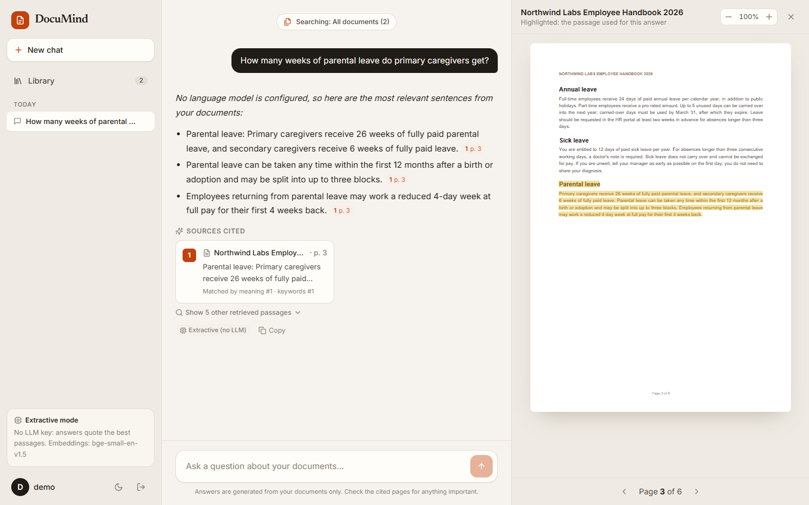
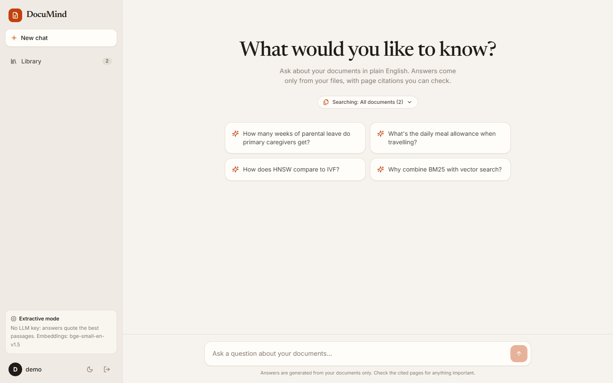
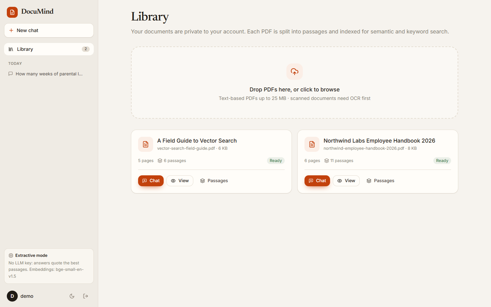
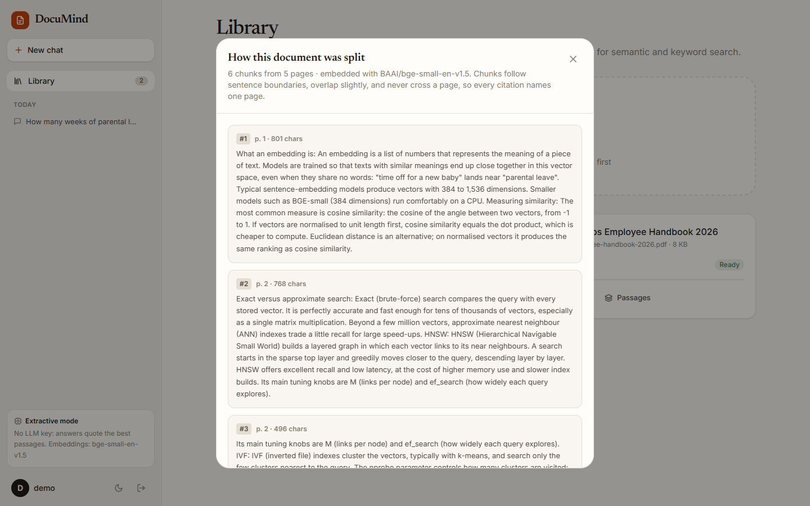
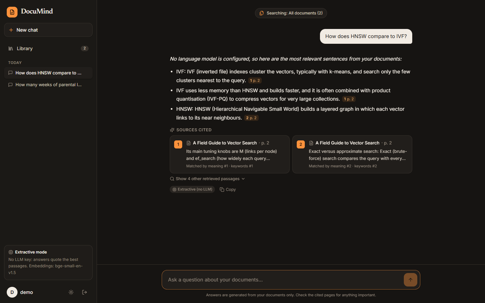
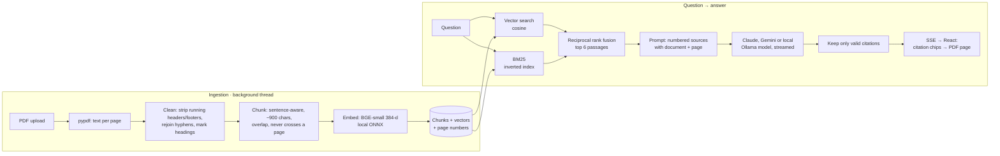

<div align="center">

# DocuMind

**Chat with your own documents.** Upload PDFs and ask questions in plain English. Answers are grounded in your files, and every claim cites the page it came from; one click opens that page with the passage highlighted.


-0F766E)




</div>

---

## Features

- **Upload PDFs** into a private per-user library. Text is extracted page by page, cleaned (running headers and footers removed, hyphenated words rejoined, headings kept), and indexed in the background.
- **Hybrid retrieval**: semantic vector search (BGE embeddings) plus BM25 keyword search, merged with reciprocal rank fusion. Paraphrases ("time off when I have a baby") and exact terms ("nprobe") both find the right page.
- **Grounded, cited answers**, **streamed token by token**, from your choice of engine: **Claude**, **Google Gemini** (free API key) or a **free local model via Ollama** (no key; documents never leave your machine). Every factual sentence carries a `[n]` citation; markers that don't match a real source are stripped.
- **Answers you can check**: citation chips show the page number, and clicking one opens a built-in PDF viewer on that page with the exact passage highlighted.
- **Transparent retrieval**: each source card says why it was retrieved (meaning rank and keyword rank), and a "Passages" view shows exactly how each document was chunked.
- **Scoped chats**: search the whole library or only selected documents. Short follow-ups ("and sick leave?") inherit context from the previous question.
- **Runs completely free**: embeddings run locally (ONNX, CPU), and answers can come from Gemini's free tier or a local Llama model through Ollama. With no LLM at all, a clearly labelled extractive mode quotes the best-matching sentences (still cited), and says so when word matching can't answer a question.
- Light and dark themes, a responsive layout, and a demo account with two sample documents.

## Screenshots

| Suggested questions | Library |
|---|---|
|  |  |

| Chunk inspector | Dark mode |
|---|---|
|  |  |

## How it works



### Design decisions

| Decision | Why |
|---|---|
| **Chunks never cross a page break** | A citation must name *one* page a reader can open. Measured on the demo set, this kept retrieval accuracy the same while making every citation exact. |
| **Hybrid search, fused with RRF** | Embeddings blur exact tokens and BM25 misses paraphrase. Rank fusion needs no score calibration and no training. |
| **One streaming interface, four engines** | Claude (SDK), Gemini (REST + SSE), Ollama (NDJSON) and extractive mode all yield plain text deltas, so the view, citation checks and UI don't know or care which model answered. |
| **Numbered sources in XML tags + `[n]` markers** | Model-agnostic, streams naturally, and easy to validate after generation: invalid numbers are removed so a chip never points nowhere. |
| **Retrieved text treated as untrusted** | The system prompt tells the model that instructions inside documents are content, not commands (basic prompt-injection hygiene). |
| **In-memory vector index per user** | Exact brute-force cosine over a normalized float32 matrix handles tens of thousands of chunks in milliseconds. It's cached and invalidated when a library changes, and it sits behind a `search()` interface so pgvector or an ANN index can replace it later. |
| **Model name stored on every chunk** | Switching embedding models never mixes incompatible vectors in one search. |
| **SSE over `fetch`, not `EventSource`** | `EventSource` can't send an `Authorization` header; a streamed `fetch` can, and it supports POST. |
| **Background thread pool for ingestion** | Uploads return instantly and the UI polls status. The pipeline is one function, ready to move to Celery or RQ. |

### Retrieval evaluation

`RetrievalEvalTests` runs eight questions against the demo documents with the real embedding model and checks where the page containing the answer ranks. The set includes a paraphrase that needs semantic search and a rare term that needs keyword search.

| Metric | Result |
|---|---|
| Answer page ranked **#1** | 6 / 8 |
| Answer page in **top 3** | 7 / 8 |
| Answer page in **top 6** (what the model sees) | **8 / 8** |

The test fails if every answer page no longer reaches the model, or if top-1 drops below 6/8, so a change to chunking, embeddings or fusion can't silently degrade quality.

## Tech stack

| Layer | Technology |
|---|---|
| Backend | Python 3.12, Django 5, Django REST Framework, SimpleJWT |
| PDF & text | pypdf, sentence-aware chunking, header/footer detection |
| Embeddings | `BAAI/bge-small-en-v1.5` via **fastembed** (ONNX Runtime, CPU); hashing fallback when offline |
| Search | NumPy cosine similarity + BM25 (inverted index) + reciprocal rank fusion |
| LLM | Anthropic Claude via the official `anthropic` SDK (`messages.stream`), Google Gemini via its REST API (`streamGenerateContent`, SSE), **or** a local model via Ollama (`/api/chat` streaming); chosen automatically |
| Frontend | React 19, TypeScript, Vite, Tailwind CSS v4, TanStack Query, react-markdown, **react-pdf** (pdf.js) |
| Ops | Docker Compose (Postgres, Gunicorn gthread, nginx with SSE-safe proxying), GitHub Actions |

## Getting started

### Option A: Docker

```bash
ANTHROPIC_API_KEY=sk-ant-...  docker compose up --build   # the key is optional
```

Open http://localhost:8082 and click **Try the demo library**.

### Option B: run locally

```bash
# Backend: http://localhost:8002
cd backend
python -m venv .venv
.venv\Scripts\activate          # macOS/Linux: source .venv/bin/activate
pip install -r requirements.txt
cp .env.example .env            # optionally add GEMINI_API_KEY (free) or ANTHROPIC_API_KEY
python manage.py migrate
python manage.py seed_demo      # demo / demo12345; downloads the ~70 MB embedding model once
python manage.py runserver 8002

# Frontend: http://localhost:5175
cd frontend
npm install
npm run dev
```

**Demo account:** `demo` / `demo12345` (or use the button on the login page). It includes a fictional *Northwind Labs Employee Handbook* (numbers that are easy to verify, such as leave days and expense limits) and *A Field Guide to Vector Search*, which explains the techniques this app uses. Both were written for this project.

### Free answers with Gemini (easiest)

1. Get a free API key at https://aistudio.google.com/apikey (sign in with Google; no card needed).
2. Put it in `backend/.env`: `GEMINI_API_KEY=your-key`
3. Restart the backend. The sidebar shows **Gemini answers**.

The free tier has per-minute and per-day request limits; DocuMind shows a clear message if you hit one. Free-tier prompts may be used by Google to improve its models, so don't upload confidential documents with this engine.

### Free local answers with Ollama

1. Install Ollama from https://ollama.com (Windows: `winget install Ollama.Ollama`).
2. Download a model: `ollama pull llama3.2` (about 2 GB; it runs on a laptop with 8 GB RAM).
3. Restart the backend. The sidebar shows **Local model answers**.

With `LLM_PROVIDER=auto` (the default), DocuMind uses Claude if `ANTHROPIC_API_KEY` is set, otherwise Gemini if `GEMINI_API_KEY` is set, otherwise Ollama if it's running with the model downloaded, otherwise extractive mode. The Ollama request sets an 8K-token context window explicitly, because Ollama's smaller default would silently cut off the retrieved passages. Small local models follow the citation format less reliably than Claude; invalid citations are removed either way.

### Configuration

| Variable | Default | Purpose |
|---|---|---|
| `LLM_PROVIDER` | `auto` | `auto`, `anthropic`, `gemini`, `ollama` or `extractive` |
| `GEMINI_API_KEY` / `GEMINI_MODEL` | *(empty)* / `gemini-2.5-flash` | Enables Gemini answers |
| `OLLAMA_MODEL` / `OLLAMA_URL` | `llama3.2` / `http://127.0.0.1:11434` | Local model via Ollama |
| `ANTHROPIC_API_KEY` | *(empty)* | Enables Claude answers |
| `ANTHROPIC_MODEL` | `claude-opus-5` | Model id |
| `LLM_EFFORT` | `low` | Claude effort level; document Q&A rarely needs deep reasoning |
| `EMBEDDING_BACKEND` | `auto` | `auto`, `local` (BGE) or `hash` |
| `CHUNK_TARGET_CHARS` / `CHUNK_OVERLAP_CHARS` | `900` / `180` | Chunking |
| `RETRIEVAL_TOP_K` | `6` | Passages sent to the model |
| `MAX_UPLOAD_MB` / `MAX_PDF_PAGES` | `25` / `500` | Upload limits |
| `DATABASE_URL` | SQLite | Postgres in Docker |

## API

| Method | Endpoint | Description |
|---|---|---|
| POST | `/api/auth/register/` · `/api/auth/login/` | JWT auth (username or email) |
| GET/POST | `/api/documents/` | List, or upload a PDF (multipart `file`) |
| GET/DELETE | `/api/documents/{id}/` | Status (`processing`, `ready`, `failed`) · delete |
| GET | `/api/documents/{id}/file/` | The PDF, owner only |
| GET | `/api/documents/{id}/chunks/` | How the document was chunked |
| GET/POST | `/api/conversations/` | List · create (optional `document_ids` scope) |
| POST | `/api/conversations/{id}/ask/` | **Server-Sent Events**: `sources` → `delta`… → `done` (or `error`) |
| GET | `/api/status/` | Which answer engine (Claude, Gemini, Ollama or extractive) and embedding model are active |

## Tests

```bash
cd backend && python manage.py test
```

30 tests covering:
- **PDF handling**: per-page extraction; rejecting non-PDF, oversized and scanned files; header/footer removal that keeps "Section 1 / Section 2" lines; hyphen joining.
- **Chunking**: never crosses pages; overlap; nothing lost; headings joined as "Heading: text" without mistaking wrapped lines for headings.
- **Search**: BM25 behaviour and a normalized, deterministic fallback embedder.
- **Grounding**: citation parsing and invalid-marker removal, follow-up query rewriting, history built only from complete question/answer pairs.
- **Answer engines**: automatic choice (Claude, then Gemini, then Ollama, then extractive); Gemini SSE parsing with role mapping, the key sent in a header rather than the URL, and friendly invalid-key and rate-limit errors; Ollama stream parsing, the context-window setting and a clear "model not downloaded" error; extractive mode admitting weak matches.
- **API**: upload → ingest → ask with the SSE event order checked; the LLM path with a mocked stream; document scoping; per-user isolation (another user can't fetch, scope or search your PDFs); auth.
- **Retrieval evaluation**: the quality benchmark above, using the real embedding model.

## Project structure

```
documind/
├── backend/
│   ├── documents/services/   pdf.py · chunking.py · embeddings.py · retrieval.py · ingest.py
│   ├── chat/services/        grounding.py (prompt, citations) · answer.py (Claude / Gemini / Ollama / extractive)
│   ├── chat/views.py         conversations + SSE /ask
│   └── core/                 demo documents, seed command, status endpoint
└── frontend/src/
    ├── pages/                ChatPage · LibraryPage · AuthPage
    ├── components/           Answer (citation chips, sources) · PdfPanel (react-pdf + highlight) · Layout
    └── lib/api.ts            typed client + SSE stream reader
```
